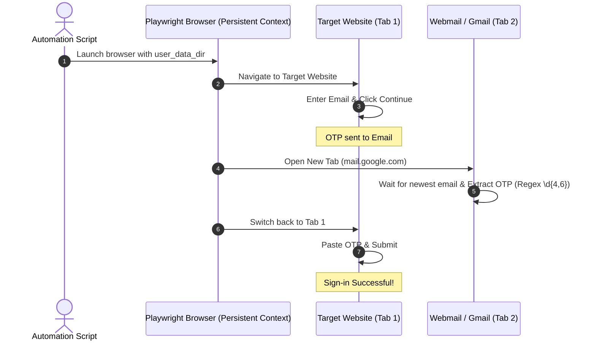

# Website Login & Automated Email OTP Handling Guide

## 1. Overview (Kya ye ho sakta hai?)

**Haan, yeh 100% possible hai.**

Aapka requirement:
1. Ek target website par jaana.
2. Email ID daal kar "Continue" / "Sign in" par click karna (jisse OTP send ho).
3. Email inbox se automatically OTP read karna (jahan aapka email pehle se login ho).
4. Target website par OTP daal kar sign in complete karna.

Is flow ko automate karne ke **2 sabse behtareen tareeqe** hain:

---

## 2. Approach Comparison (Kaunsa tareeka behtar hai?)

| Feature | Method 1: Persistent Browser Profile (Multi-Tab UI) | Method 2: Browser (Target Site) + IMAP/API (Email Fetch) |
| :--- | :--- | :--- |
| **Kaise kaam karta hai** | Ek hi browser window mein 2 tabs: Tab 1 (Target site) aur Tab 2 (Gmail/Webmail). | Target site Playwright browser mein open hogi, lekin OTP background mein direct mail server (IMAP) se aayega. |
| **Email Login Setup** | Browser profile mein aapko 1 baar manual login karna hota hai. | Email ka App Password / IMAP enable karna hota hai. |
| **Speed** | 5 – 10 seconds | 2 – 4 seconds (Super Fast) |
| **Stability** | Webmail ka UI badalne par selector change karna pad sakta hai. | 100% stable (UI changes se koi farq nahi padta). |
| **Recommendation** | Agar IMAP allow nahi hai toh ye best hai. | **Industry standard & recommended.** |

---

## 3. Method 1: Persistent Browser Profile (Playwright Multi-Tab)

Is tareeqe mein ek custom Chrome directory banayi jaati hai jisme aapka Gmail/Webmail hamesha logged-in rehta hai.

### Workflow:


### Python Playwright Code Example (Method 1)

```python
import re
import time
from playwright.sync_api import sync_playwright

USER_DATA_DIR = "./browser_profile"  # Is folder me aapka email login save rahega
TARGET_URL = "https://example.com/login"
USER_EMAIL = "your-email@gmail.com"

def run_automation():
    with sync_playwright() as p:
        # Launch browser with persistent profile (session will be saved)
        context = p.chromium.launch_persistent_context(
            user_data_dir=USER_DATA_DIR,
            headless=False,  # Browser visible rahega taaki aap dekh sakein
            channel="chrome"
        )
        
        # Tab 1: Target website
        page = context.pages[0] if context.pages else context.new_page()
        print("Navigating to target website...")
        page.goto(TARGET_URL)
        
        # Step 1: Email daalna
        page.fill("input[type='email']", USER_EMAIL)
        page.click("button:has-text('Continue'), button:has-text('Sign In'), button[type='submit']")
        print("Email submitted! Waiting for OTP...")

        # Step 2: Tab 2 mein Email open karna
        email_page = context.new_page()
        email_page.goto("https://mail.google.com")
        
        # Agar pehli baar hai to manual login check
        time.sleep(5)  # OTP aane ka intezar
        
        # Latest email row click karna (Gmail example)
        email_page.wait_for_selector("tr.zA", timeout=15000)
        latest_email = email_page.locator("tr.zA").first
        latest_email.click()
        
        # Email body se OTP extract karna
        email_page.wait_for_selector(".a3s", timeout=10000)
        body_text = email_page.locator(".a3s").inner_text()
        
        # 4 se 6 digit ka OTP dhoondna
        match = re.search(r'\b\d{4,6}\b', body_text)
        if not match:
            print("OTP nahi mila!")
            return
            
        otp = match.group(0)
        print(f"OTP mil gaya: {otp}")
        email_page.close() # Email tab band kar do

        # Step 3: Wapas Tab 1 par aakar OTP fill karna
        page.bring_to_front()
        page.fill("input[name='otp'], input[placeholder*='code' i], input[type='text']", otp)
        page.click("button:has-text('Verify'), button:has-text('Submit')")
        print("Login complete!")

        time.sleep(5)
        context.close()

if __name__ == "__main__":
    run_automation()
```

---

## 4. Method 2: Browser (Target Site) + IMAP Protocol (Sabse Fast & Reliable)

Is tareeqe mein browser sirf target website ke liye use hota hai, aur OTP directly email server se IMAP ke zariye fetch kiya jaata hai. Isme email tab kholne ki zaroorat nahi padti.

### Python Code Example (Method 2)

```python
import imaplib
import email
import re
import time
from playwright.sync_api import sync_playwright

IMAP_SERVER = "imap.gmail.com"
EMAIL_ACCOUNT = "your-email@gmail.com"
APP_PASSWORD = "your-app-password"  # Gmail App Password (2-step verification se banta hai)

def fetch_latest_otp(timeout_seconds=30):
    """Background me email inbox se OTP fetch karta hai"""
    print("Waiting for OTP email via IMAP...")
    start_time = time.time()
    
    mail = imaplib.IMAP4_SSL(IMAP_SERVER)
    mail.login(EMAIL_ACCOUNT, APP_PASSWORD)
    mail.select("inbox")

    while time.time() - start_time < timeout_seconds:
        # Sirf unread emails search karna
        status, messages = mail.search(None, 'UNSEEN')
        mail_ids = messages[0].split()
        
        if mail_ids:
            latest_id = mail_ids[-1]
            status, data = mail.fetch(latest_id, '(RFC822)')
            msg = email.message_from_bytes(data[0][1])
            
            # Email body nikaalna
            body = ""
            if msg.is_multipart():
                for part in msg.walk():
                    if part.get_content_type() == "text/plain":
                        body = part.get_payload(decode=True).decode(errors='ignore')
                        break
            else:
                body = msg.get_payload(decode=True).decode(errors='ignore')

            # 4 ya 6 digit OTP pattern match
            match = re.search(r'\b\d{4,6}\b', body)
            if match:
                otp = match.group(0)
                mail.logout()
                return otp

        time.sleep(2)
        
    mail.logout()
    return None

def run():
    with sync_playwright() as p:
        browser = p.chromium.launch(headless=False)
        page = browser.new_page()
        
        # 1. Target Website
        page.goto("https://example.com/login")
        page.fill("input[type='email']", EMAIL_ACCOUNT)
        page.click("button[type='submit']")
        
        # 2. OTP Fetch (Background)
        otp = fetch_latest_otp()
        if not otp:
            print("OTP receive nahi hua!")
            return
            
        print(f"OTP received: {otp}")
        
        # 3. Enter OTP
        page.fill("input[name='otp']", otp)
        page.click("button:has-text('Verify')")
        
        print("Successfully Logged In!")
        time.sleep(5)
        browser.close()

if __name__ == "__main__":
    run()
```

---

## 5. Kaam shuru karne ke liye agle steps (Next Steps)

1. **Aap website ka URL bataiye:** Jis website par login karna hai, uska URL aur login page structure kaisa hai?
2. **Email kis provider ka hai?** (Gmail, Outlook, ya Custom Corporate Webmail?)
3. **Kaunsa tareeka aapko pasand hai?**
   - Option A: Persistent Chrome Window (jahan aap ek baar Gmail manually login kar denge).
   - Option B: Headless IMAP/App Password (zyada fast aur robust).

Aap website aur requirements share karein, hum turant script build karke test kar lenge!

