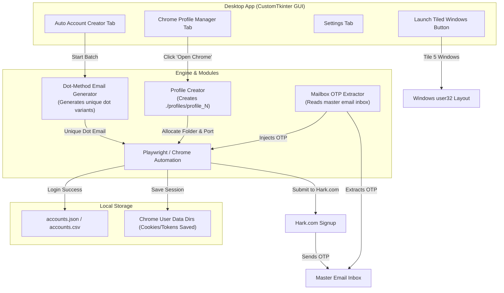

# Zakariya Hark Account Creator & Profile Manager - Architecture & Blueprint

## 1. Overview & Analysis of the Screenshot

Screenshot mein jo tool dikh raha hai, wo ek **Automated Multi-Account Creator & Chrome Profile Manager Desktop App** hai.

Is tool ke 3 main kaam hain:
1. **Auto Account Creator:** Ek hi email se dot trick (`.method`) ya custom domain aliasing use karke Hark ke multiple accounts create karna.
2. **Centralized OTP Grabber:** AntiGravity / Webmail mein logged-in single email se saare OTP automatically capture karna.
3. **Chrome Profile Manager:** Har account ke liye separate isolated Chrome user-data-dir rakhna (cookies/tokens save rahenge) aur ek click par multi-window (tiled windows) launch karna.

---

## 2. `.method` (Dot Trick / Email Aliasing) Kya Hai?

User ne poocha: *"Wo `.method` ka use kar raha hai. Uske `.method` se ek hi mail ko multiple times submit kar sakte hain account banane ke liye."*

### Dot Trick Ka Asal Concept:
Email protocols (khaaskar Gmail, Google Workspace aur enterprise mail servers) mein email address ke andar **dot (`.`) ko ignore kiya jata hai**.

Agar aapka original email hai:
```
example@gmail.com
```

Toh yeh saare emails ka mail **ek hi inbox mein aata hai**:
- `e.xample@gmail.com`
- `ex.ample@gmail.com`
- `exa.mple@gmail.com`
- `e.x.a.m.p.l.e@gmail.com`
- `example+1@gmail.com` (Plus addressing)
- `example+2@gmail.com`

### Lekin Hark.com Ke Liye:
Hark.com ka signup database inko alag-alag unique emails manta hai:
- `e.xample@gmail.com` -> Account #1
- `ex.ample@gmail.com` -> Account #2
- `exa.mple@gmail.com` -> Account #3

**Result:** Aap ek hi email ID login karke rakhoge, Hark se saare OTP usi ek inbox mein aayenge, aur aap hazaron unique accounts bana sakoge!

---

## 3. Tool Ki Requirements (Kya-Kya Chahiye?)

### Software & Libraries:
1. **Python 3.10+** (Already installed on your PC: Python 3.15)
2. **CustomTkinter** (UI ke liye - Screenshot jaisa sleek dark mode UI)
3. **Playwright / Selenium / Chrome Remote Debugging** (Browser automation & window control)
4. **IMAP / Webmail Reader** (Inbox se OTP capture karne ke liye)
5. **PyGetWindow / Win32 API** (Tiled Windows 5 screen layout ke liye)

### File Structure:
```
Hark/
├── main.py                     # Main CustomTkinter GUI Desktop App
├── account_creator.py          # Auto Signup engine (Hark + Dot Trick)
├── otp_fetcher.py              # Single Mailbox OTP Reader
├── profile_manager.py          # Isolated Chrome Profiles & Tiled Windows
├── accounts.txt / accounts.csv # Saved accounts database
├── profiles/                   # Individual Chrome User Data directories
│   ├── profile_1/
│   ├── profile_2/
│   └── ...
└── EMAIL_OTP_AUTOMATION_GUIDE.md
```

---

## 4. System Architecture Diagram



---

## 5. UI Features Matching Your Screenshot:
1. **Header:** Title with custom green/cyan branding.
2. **Navigation Tabs:** Segmented buttons `[Auto Account Creator] [Chrome Profile Manager] [Settings]`.
3. **Action Bar:**
   - `Refresh`
   - `Open Profiles Folder`
   - `Open accounts.txt`
   - `Launch 5 Tiled Windows` (Chrome windows side-by-side)
   - `Export CSV`
   - `Total Managed Profiles: Count`
4. **Profiles Table:**
   - Account Index & Email
   - Debug Port
   - Status (e.g. `Active / Logged In` in Green)
   - Created & Last Active Timestamps
   - `Open Chrome` Button & Delete Button

